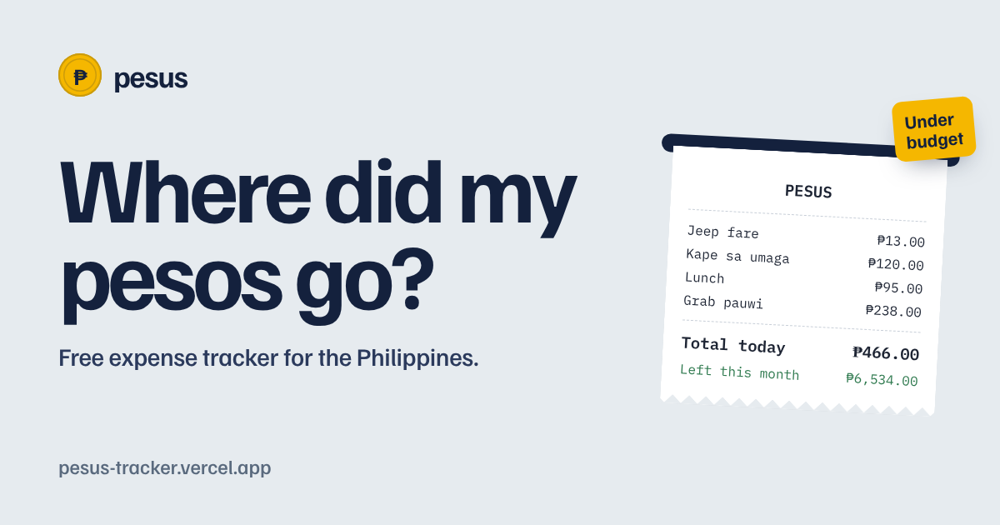

<div align="center">


# Pesus

**Where did my pesos go?** A free expense tracker for everyday spending in the Philippines.

[Live app](https://pesus-tracker.vercel.app) · [Report an issue](https://github.com/jerald28/Expenses-Tracker/issues)



</div>

## About

Pesus helps you log what you spend in pesos, see where it goes, and stay under a monthly budget. Sign in with Google, add an expense in a few taps, and your dashboard shows what you spent today, this week and this month, broken down by category. It installs on Android and iPhone straight from the browser, with no app store needed.

## Features

- **Quick expense logging:** amount, description, date, category and optional notes
- **Dashboard:** totals for today, this week and this month, plus top categories and recent expenses
- **Monthly budget:** a progress bar with what is left, and a daily average for the week
- **Ledger:** search and filter past expenses by period and category
- **Google sign-in with cloud sync:** your data follows you across devices
- **Installable app (PWA):** add to the home screen on Android and iPhone; it opens fast, even on a weak connection
- **Light and dark mode**, peso and other currencies, backup and restore to a file
- **Search and AI friendly:** the landing page is rendered to HTML at build time, with structured data, a sitemap, `robots.txt` and `llms.txt`

## Tech stack

| Area | Tools |
| --- | --- |
| UI | React 19, TypeScript, Tailwind CSS 4 |
| Animation | GSAP (landing page), Motion (app screens) |
| Build | Vite 6, vite-plugin-pwa (Workbox) |
| Backend | Firebase Authentication (Google) and Cloud Firestore |
| Hosting | Vercel |
| Fonts | Familjen Grotesk, IBM Plex Mono (self-hosted via Fontsource) |

## Getting started

**Requirements:** Node.js 20 or newer.

```bash
git clone https://github.com/jerald28/Expenses-Tracker.git
cd Expenses-Tracker
npm install
npm run dev
```

The app runs at `http://localhost:5173`. Google sign-in works on `localhost` because Firebase allows it by default.

### Scripts

| Command | What it does |
| --- | --- |
| `npm run dev` | Start the development server |
| `npm run build` | Build for production into `dist/` (also pre-renders the landing page and writes the sitemap, `robots.txt` and `llms.txt`) |
| `npm run preview` | Serve the production build locally |
| `npm run lint` | Type-check the project |
| `npm run og-image` | Regenerate the social share image (needs Python and Playwright) |

## Firebase setup

The app uses the Firebase project configured in [`src/lib/firebase.ts`](src/lib/firebase.ts). To use your own project:

1. Create a project in the [Firebase console](https://console.firebase.google.com).
2. **Authentication:** enable the Google sign-in provider, and add your site's domain under *Settings → Authorized domains*.
3. **Firestore:** create a database and publish the rules in [`firestore.rules`](firestore.rules).
4. **Web app:** register a web app and paste its config into `src/lib/firebase.ts`.

### Data model

```
users/{userId}                        one document per user
  email, displayName
  currency, budgetLimit, budgetEnabled, theme, updatedAt

users/{userId}/expenses/{expenseId}   one document per expense
  amount, description, date, categoryId, notes, createdAt
```

The security rules allow each signed-in user to read and write only their own documents.

## Deployment

The app deploys to Vercel automatically: every push to `main` goes to production, and other branches get preview links.

When you move to a custom domain:

1. Add the domain in Vercel.
2. Add it to Firebase *Authentication → Settings → Authorized domains*.
3. Set the `SITE_URL` environment variable in Vercel (see [`.env.example`](.env.example)) so the canonical URL, sitemap and share tags point to it.

## Project structure

```
src/
  App.tsx                 app shell, auth flow and tab navigation
  main.tsx                entry point (hydrates the pre-rendered landing page)
  entry-prerender.tsx     build-time render of the landing page
  components/
    LandingPage.tsx       marketing page (receipt hero, photo carousel, FAQ)
    AuthPage.tsx          sign in / create account
    Dashboard.tsx         totals, budget and recent expenses
    ExpenseList.tsx       ledger with search and filters
    ExpenseFormPage.tsx   add and edit expenses
    Settings.tsx          account, appearance, budget, backup
    InstallApp.tsx        install button and instructions
    landing.css           landing and sign-in styles
  content/faq.ts          FAQ shown on the page and in structured data
  lib/
    firebase.ts           Firebase app and Google sign-in
    db.ts                 Firestore reads and writes (loaded after sign-in)
    pwa.ts                service worker and install prompt
seo.config.ts             SEO tags, structured data, sitemap, robots.txt, llms.txt
firestore.rules           Firestore security rules
public/                   icons, share image, verification files
```

## Credits

- Photos from [Pexels](https://www.pexels.com) (free to use under the Pexels license)
- Designed and developed by [Jerald Esguerra](https://jeraldesguerra.vercel.app/), UI/UX Developer
